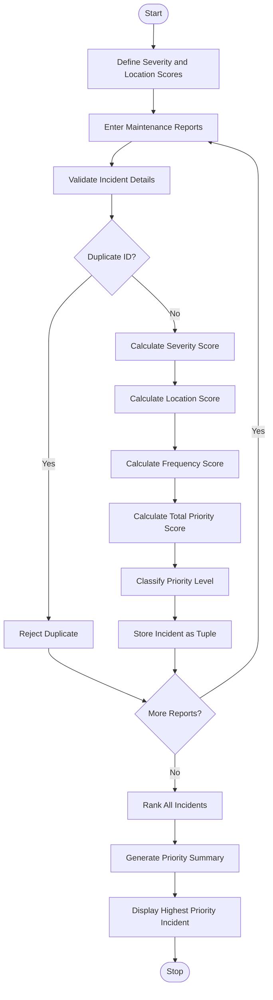

# Smart-campus
# Smart Campus Incident and Maintenance Prioritization System

## 1. Project Overview

The **Smart Campus Incident and Maintenance Prioritization System** is a Python-based application designed to classify, analyse, and prioritize campus maintenance reports.

The system evaluates maintenance incidents based on severity, location, and reported frequency. It calculates a priority score for each incident, ranks the incidents from highest to lowest priority, and generates a priority summary.

This system helps campus administrators identify important maintenance problems and decide which issues require immediate attention.

## 2. Objectives

- To collect campus maintenance reports.
- To classify incidents based on severity.
- To assign importance scores to campus locations.
- To analyse the frequency of reported problems.
- To calculate the priority score of each incident.
- To detect duplicate incident IDs.
- To rank incidents according to predefined rules.
- To generate a summary of critical, high, medium, and low priority incidents.
- To identify the first incident that should be resolved.

## 3. Assumptions

1. Each maintenance report has a unique incident ID.
2. Severity is classified as Low, Medium, High, or Critical.
3. Each campus location has a predefined importance score.
4. Reported frequency must be a positive integer.
5. Critical incidents receive the highest severity score.
6. Higher-priority locations receive higher location scores.
7. Incidents are ranked using their total priority scores.
8. If two incidents have the same total score, higher severity receives preference.
9. If severity is also equal, higher reported frequency receives preference.
10. Duplicate incident IDs are rejected.

## 4. Priority Scoring Rules

### Severity Scores

| Severity | Score |
|---|---:|
| Critical | 40 |
| High | 30 |
| Medium | 20 |
| Low | 10 |

### Location Scores

| Location | Score |
|---|---:|
| Laboratory | 30 |
| Electrical Room | 30 |
| Library | 20 |
| Classroom | 20 |
| Cafeteria | 10 |
| Playground | 10 |
| Other | 5 |

### Frequency Scores

| Reported Frequency | Score |
|---|---:|
| 1–2 reports | 5 |
| 3–5 reports | 10 |
| More than 5 reports | 20 |

## 5. Formula Used

### Total Priority Score

Priority Score = Severity Score + Location Score + Frequency Score

Example:

- Severity: Critical = 40
- Location: Laboratory = 30
- Frequency: 6 reports = 20

Total Priority Score = 40 + 30 + 20 = 90

### Priority Classification

| Total Score | Priority Level |
|---|---|
| 80 and above | Critical |
| 60–79 | High |
| 40–59 | Medium |
| Below 40 | Low |

### Ranking Rules

Incidents are ranked according to:

1. Higher total priority score.
2. Higher severity score when total scores are equal.
3. Higher reported frequency when both previous values are equal.

## 6. Algorithm

1. Start the program.
2. Define severity scores.
3. Define location scores.
4. Enter the number of maintenance reports.
5. Enter the incident ID.
6. Enter the problem description.
7. Enter the severity level.
8. Enter the campus location.
9. Enter the reported frequency.
10. Validate the entered details.
11. Check for duplicate incident IDs.
12. Calculate the severity score.
13. Calculate the location score.
14. Calculate the frequency score.
15. Calculate the total priority score.
16. Classify the incident into a priority level.
17. Store the incident details in a tuple.
18. Repeat the process for all reports.
19. Rank incidents using predefined rules.
20. Display the ranked maintenance reports.
21. Calculate the number of incidents in each priority category.
22. Display the priority summary.
23. Identify the first incident to resolve.
24. Stop the program.

## 7. Pseudocode

```text
START

DEFINE severity scores
DEFINE location scores

INPUT number of maintenance reports

CREATE empty incident list
CREATE empty incident ID list

FOR each incident:

    INPUT incident ID
    INPUT problem description
    INPUT severity
    INPUT location
    INPUT reported frequency

    CHECK duplicate incident ID

    IF duplicate:
        REJECT record

    ELSE:

        VALIDATE severity
        VALIDATE location
        VALIDATE frequency

        CALCULATE severity score
        CALCULATE location score
        CALCULATE frequency score

        priority score =
            severity score +
            location score +
            frequency score

        CLASSIFY priority level

        STORE incident as a tuple

SORT incidents using:

    1. Total priority score
    2. Severity score
    3. Reported frequency

DISPLAY ranked incidents

COUNT critical incidents
COUNT high priority incidents
COUNT medium priority incidents
COUNT low priority incidents

DISPLAY priority summary

DISPLAY first incident to resolve

STOP
```

## 8. Flowchart



## 9. Test Cases

| Test Case | Severity | Location | Frequency | Expected Score | Priority |
|---|---|---|---:|---:|---|
| 1 | Critical | Laboratory | 6 | 90 | Critical |
| 2 | High | Classroom | 4 | 60 | High |
| 3 | Medium | Cafeteria | 7 | 50 | Medium |
| 4 | Low | Playground | 1 | 25 | Low |
| 5 | High | Other | 6 | 55 | Medium |

### Additional Test Cases

**Test Case 1: Duplicate Incident**

- Incident ID: INC101
- Enter the same ID again.
- Expected result: Duplicate incident rejected.

**Test Case 2: Invalid Severity**

- Enter severity as Extreme.
- Expected result: Invalid severity message.

**Test Case 3: Invalid Frequency**

- Enter frequency as 0.
- Expected result: Frequency must be positive.

**Test Case 4: Critical Incident**

- Severity: Critical
- Location: Laboratory
- Frequency: 6
- Expected score: 90
- Expected result: Critical priority.

## 10. Sample Output

```text
==============================================
          PRIORITY SUMMARY
==============================================

Total Valid Incidents: 5
Critical Priority: 1
High Priority: 1
Medium Priority: 2
Low Priority: 1

First Incident to Resolve:
Incident ID: INC101
Description: Electrical short circuit
Priority: CRITICAL

==============================================
Incident analysis completed successfully.
==============================================
```

## 11. Python Concepts Used

- Variables and data types
- Input and output statements
- Tuples
- Lists
- Dictionaries
- Conditional statements (if, elif, else)
- For loops
- Functions
- Function arguments and return values
- Arithmetic operators
- Logical operators
- Sorting
- Lambda functions
- List operations

## 12. Conclusion

The Smart Campus Incident and Maintenance Prioritization System successfully classifies and ranks campus maintenance reports using predefined priority rules.

It analyses incident severity, location importance, and reported frequency to calculate priority scores. It also identifies duplicate reports, ranks incidents, and generates a summary of maintenance priorities.

This project demonstrates the practical application of Python concepts such as tuples, lists, dictionaries, functions, loops, conditional statements, and sorting in solving real-world campus maintenance problems.

## 13. Project Structure

```text
Smart-Campus-Incident-Prioritization/
│
├── campus_maintenance.py
├── README.md
│
└── screenshots/
    └── output.png
```

## 14. Execution Instructions

1. Install Python on your computer.
2. Open the project folder in Visual Studio Code.
3. Open `campus_maintenance.py`.
4. Run the program using:

```bash
python campus_maintenance.py
```

5. Enter the number of maintenance reports.
6. Provide incident ID, description, severity, location, and frequency.
7. View the ranked incidents.
8. Check the priority summary.
9. Capture the actual program output screenshot.
10. Upload the Python file, README, and screenshot to GitHub.

## 15. Author Details

- **Name:**  v.v.s.s.gayathri
- **Roll Number:** N26V01A0388
- **Branch:** CSE
- **Section:** Section-5
- **Subject:** Python Programming
- **Project:** Smart campus
